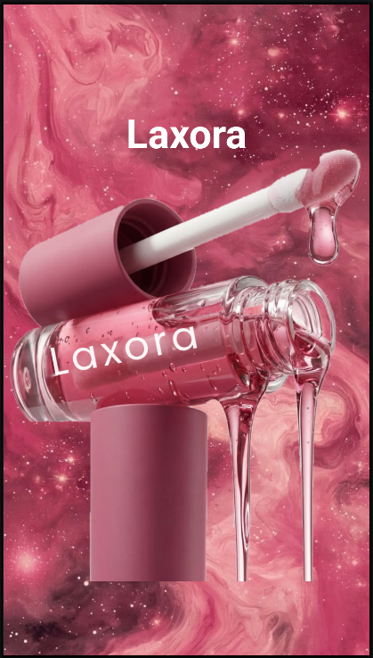
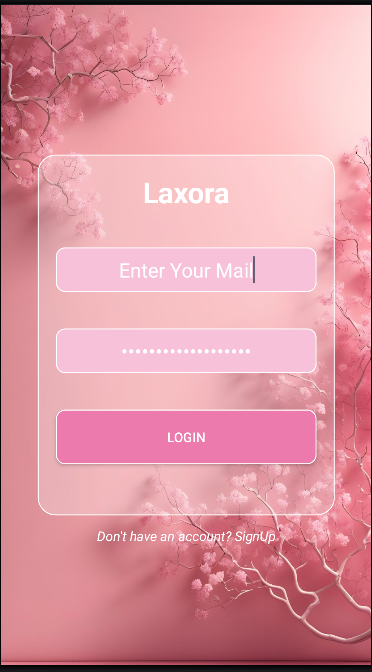
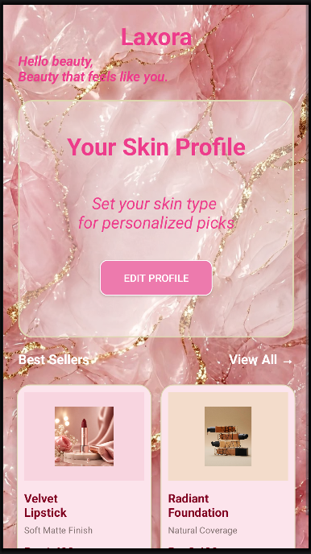
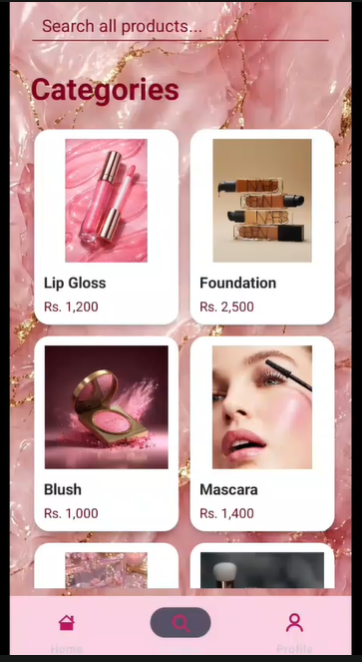
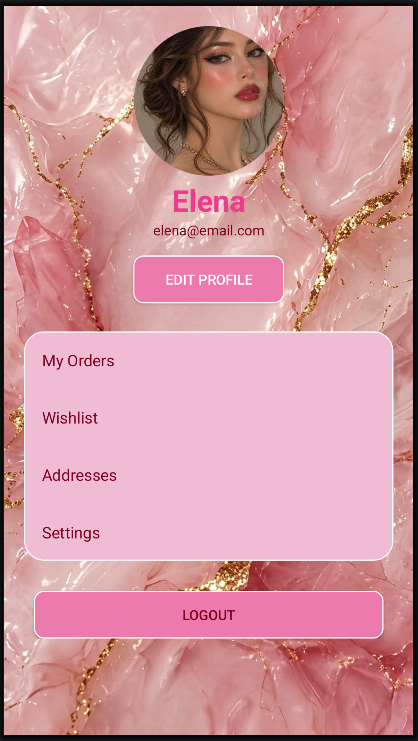

<div align="center">


<a href="https://github.com/h-hibaaah/Laxora">
  
</a>

<br/>


<br/>

[](https://github.com/h-hibaaah/Laxora)
[](https://github.com/h-hibaaah/Laxora/issues)
[](https://github.com/h-hibaaah)

</div>


## About

Laxora is an Android makeup shopping application developed with Kotlin and XML. It offers a simple, elegant shopping interface where users can explore makeup products through an organized and user-friendly layout.


## Features

| Feature | Description |
| :--- | :--- |
| **Splash Screen** | A welcoming introduction to the application |
| **Login Screen** | A dedicated login interface |
| **Home Screen** | Explore the makeup shopping interface |
| **Product Listing** | Browse different makeup products |
| **RecyclerView** | Display products in an organized list |
| **Search** | Search for makeup products |
| **Navigation** | Move easily between application screens |
| **Pink Themed UI** | A modern interface with a consistent pink design |


## Product Categories

<div align="center">


</div>


## Screenshots

<div align="center">

| Splash | Login | Home | Products |
| :---: | :---: | :---: | :---: |
|  |  |  |  |
|  | 
</div>


## Technologies Used

| Category | Technology |
| :--- | :--- |
| **Language** | Kotlin |
| **UI Design** | XML |
| **IDE** | Android Studio |
| **UI Components** | RecyclerView, Material Design |
| **Version Control** | Git and GitHub |

## Design

Laxora follows a clean, elegant design approach with a pink color palette to create a consistent shopping experience.

<div align="center">


</div>

## Getting Started

```bash
# Clone the repository
git clone https://github.com/h-hibaaah/Laxora.git

# Open the project in Android Studio, let Gradle sync, then run on an emulator or device
```

## Development

This project was developed as part of my Android development learning journey, to gain practical experience in Kotlin, XML layouts, Android UI components, and application navigation.


## Developer

<div align="center">

**Hibaaah**

BS Computer Science Student | Android Developer

[](https://github.com/h-hibaaah)

<br/>

If you find this project interesting, consider giving it a star.

[](https://github.com/h-hibaaah/Laxora)


</div>
